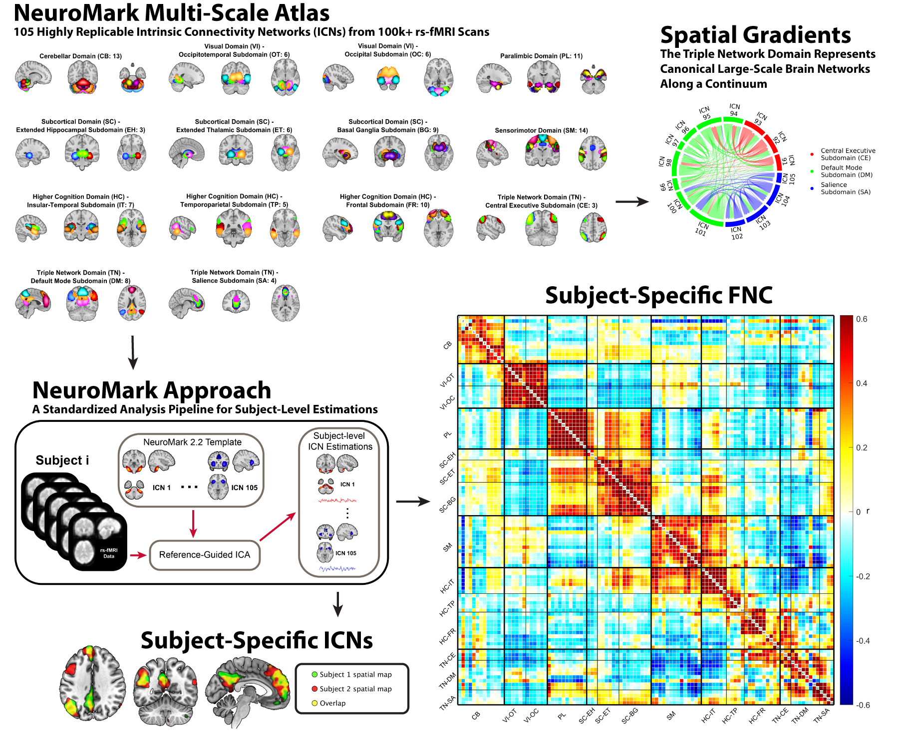

## NeuroMark Templates for [TReNDS Center](https://trendscenter.org/) implemented under GIFT Toolbox
NeuroMark templates provide a robust decomposition of the whole brain into functionally meaningful components, enabling efficient and scalable analyses of thousands of subjects. 
- Functional Magnetic Resonance Imaging (MRI)
    - Single-scale
        - Gray Matter (GM)
            - <a href="./functionalMRI/Neuromark_fMRI_2.0_modelorder-25.md">Low-order</a> (Model order: 25, v2.0)
            - <a href="./functionalMRI/Neuromark_fMRI_1.0.md">Conventional-order</a> (Model order: 100, v1.0) 
            - <a href="./functionalMRI/Neuromark_fMRI_2.0_modelorder-175.md">High-order</a> (Model order: 175, v2.0)
            - <a href="./functionalMRI/Neuromark_fMRI_2.2_modelorder-500.md">Ultra-high-order</a> (Model order: 500, v2.2)
    - Multi-scale
        - <a href="./functionalMRI/Neuromark_fMRI_2.2_modelorder_multi.md">Gray Matter</a> (Model order: multi, v2.2)
            - <a href="./functionalMRI/Neuromark_Template_2.2_fMRI_SZ.md">Disease-specific</a> (Model order: multi, v2.2)
        - <a href="./functionalMRI/Neuromark_fMRI_WM_2.2_modelorder-multi.md">White Matter (WM)</a> (Model order: multi, v2.2)
        - <a href="./functionalMRI/Neuromark_fMRI_WMGM_2.2_modelorder-multi.md">White Matter + Gray Matter</a> (Model order: multi, v2.2)
    - Developmental
        - Gray Matter
            - <a href="./functionalMRI/Neuromark_fMRI_3.0_infant_modelorder-100.md">Infants</a> (Model order: 100, v3.0)
            - <a href="./functionalMRI/Neuromark_fMRI_3.0_development_modelorder-100.md">Children</a> (Model order: 100, v3.0)
            - <a href="./functionalMRI/Neuromark_fMRI_3.0_aging_modelorder-100.md">Aging-adults</a> (Model order: 100, v3.0)
    - <a href="./functionalMRI/RSN_28.md">Resting State Data (Legacy)</a> (Model order: 75, v0.1)
- Positron Emission Tomography (PET)
    - Single-scale
        - Gray Matter 
            - <a href="./PET/Neuromark_PET-FBP_1.0_modelorder-40_2x2x2.md">Low-order</a> (Model order: 40, v1.0)
        - White Matter + Gray Matter
            - <a href="./PET/Neuromark_PET-FBP_WMGM_2.0_modelorder-100_3x3x3.md">High-order</a> (Model order: 100, v2.0)
- Single-Photon Emission Computed Tomography (SPECT)
    - Single-scale 
        - Gray Matter
            - <a href="./SPECT/Neuromark_SPECT-TC99_1.0.md">Conventional-order</a> (Model order: 100, v1.0)
- Structural MRI
    - Single-scale
        - Gray Matter
            - <a href="./StructuralMRI/Neuromark_sMRI_1.0_modelorder-30_2x2x2.md">Low-order</a> (Model order: 100, v1.0)
            - <a href="./StructuralMRI/Neuromark_sMRI_3.0_modelorder-100_3x3x3.md">High-order</a> (Model order: 30, v3.0)
- Diffusion MRI
    - Single-scale 
        - White Matter
            - <a href="./diffusionMRI/Neuromark_dMRI_3.0_modelorder-100_3x3x3.md">High-order</a> (Model order: 100, v3.0)
---

